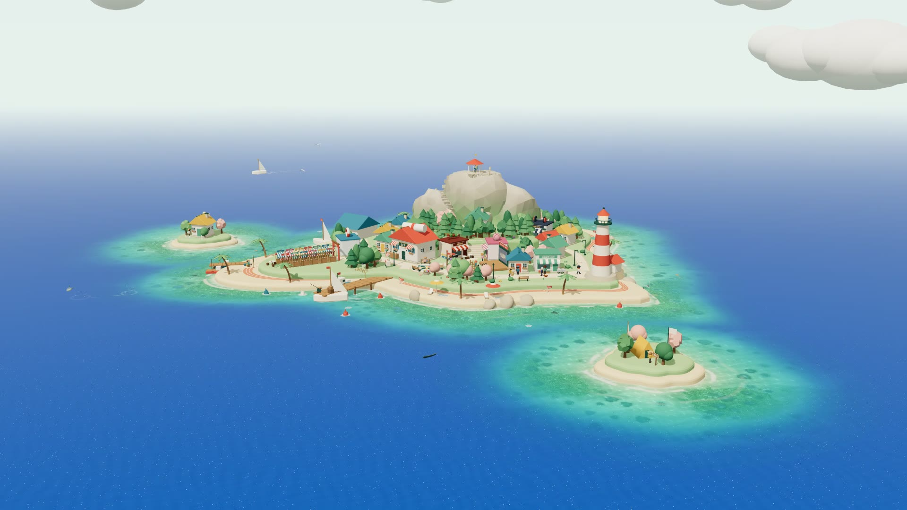
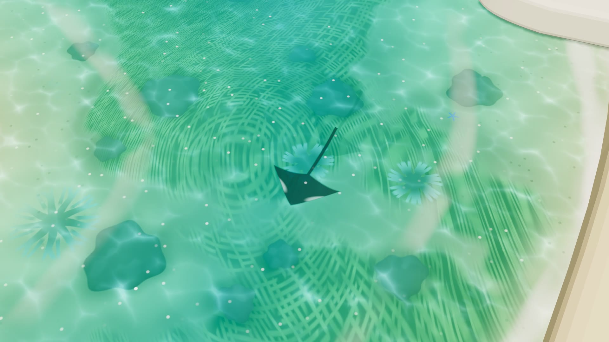
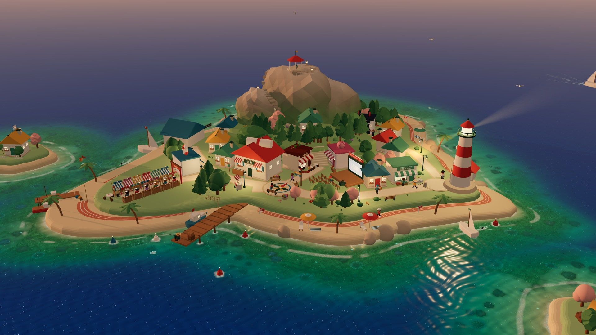
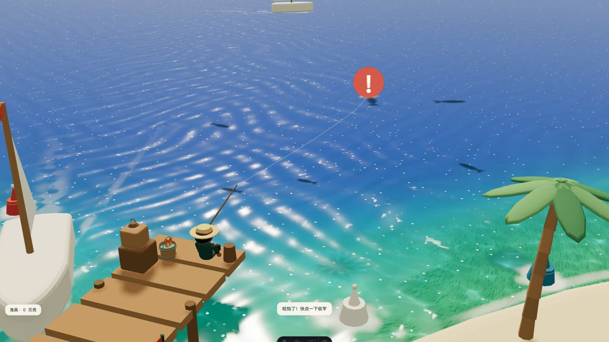
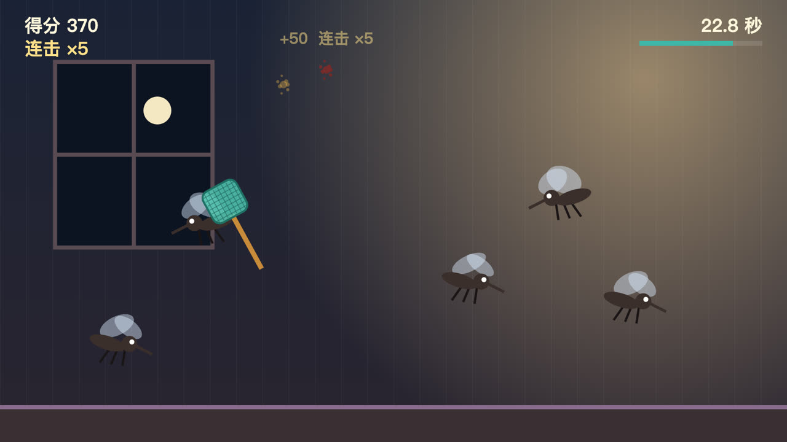
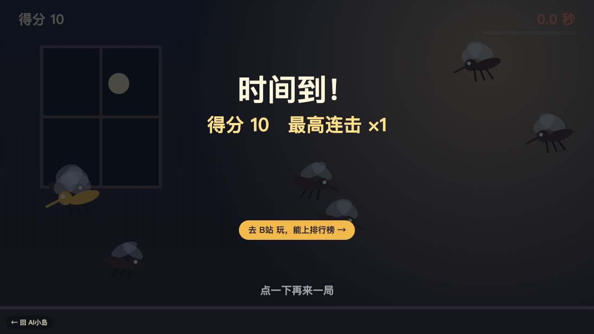

# xiaodao-island · 小岛AI 网站的代码

[xiaodao.ai](https://xiaodao.ai) 的网站代码：一个 Astro 静态站，首页是一座可以逛的 3D 小岛（three.js），文章、日报和视频都住在岛上。

[](https://xiaodao.ai)

[上岛逛逛 →](https://xiaodao.ai)

这个仓库**只放代码**，文章和日报换成了几篇示例。真正的网站内容在另一个私有仓库里，网站代码有更新时会同步过来。

- 怎么做出来的，B 站有两支视频拆过：[《我的 3D 小岛是怎么做出来的？》](https://www.bilibili.com/video/BV1SDHG6GEih/)（海水、鱼群、灯塔一层层拆开）和[《搞懂 Git Worktree，再 Vibe Coding》](https://www.bilibili.com/video/BV15kxN6gEge/)。
- 很多代码是我和 AI（Claude、Codex）一起写的。

## 岛上有什么

下面都是网站实际运行的画面。

| 浅海里的生命 | 黄昏与灯塔 |
|---|---|
|  |  |
| 海水颜色、折射、沙纹、水草和游动的鱼，都由代码绘制。海水入口：[ocean-glsl.ts](src/island/ocean-glsl.ts)。 | 岛上有昼夜变化、灯塔和海浪声。相关实现都在 [src/island/](src/island/)。 |

## 两个小游戏

| 码头钓鱼 | 啪！拍蚊子 |
|---|---|
|  |  |
| 首页点「钓鱼」接过周伯的鱼竿：甩竿、等鱼影游过来、咬钩时收竿，钓上来的鱼叼着一篇旧文章。代码在 [fishing.ts](src/island/fishing.ts)。 | 30 秒拍蚊子，连着拍中有连击加分。单个 HTML 文件，canvas 画面，[在线玩](https://xiaodao.ai/play/mosquito/)。代码在 [public/play/mosquito/index.html](public/play/mosquito/index.html)。 |

拍蚊子也上架了 B站 Toy，在那里玩能上排行榜：[bilibili.com/toy/paiwenzi](https://www.bilibili.com/toy/paiwenzi/index.html)。同一份代码在 B站 里会加载官方 SDK，交分数、拉排行榜；在别处打开只显示自己的分数，结束时给一个去 B站 的入口。



做这个游戏和上架 Toy 的过程，B 站有一支视频：[《B站点开就能玩的小游戏是怎么做的？拆完我也用 AI 做了一个》](https://www.bilibili.com/video/BV1hP4n6LEHo/)。

## 跑起来

```bash
bun install        # 或 npm install
bun run dev        # http://localhost:4321
bun run build      # 产物在 dist/
```

需要 Node 20+。不需要任何密钥或环境变量。

## 换成你自己的内容

| 放什么 | 放哪里 |
|---|---|
| 文章（Markdown，开头写 title / summary / pubDate） | `src/content/posts/` |
| 文章里的图片 | `public/posts/<文章文件名>/images/` |
| 日报（一天一个 JSON） | `src/data/daily/` |
| B 站视频列表 | `src/data/videos.json`，封面在 `public/videos/` |
| 站点地址、关于页、图标 | `astro.config.mjs` 的 `site`、`src/pages/about.astro`、`public/` 下的图标 |
| 给 AI 爬虫看的站点说明 | `public/llms.txt` |

## 目录

| 路径 | 是什么 |
|---|---|
| `src/island/` | 3D 小岛：地形、海水着色器（`ocean-glsl.ts`）、鱼群、灯塔、昼夜、镜头 |
| `src/island/fishing.ts`、`fishing-gear.ts` | 码头钓鱼小游戏：甩竿、鱼影、咬钩、收进鱼桶；贝壳升级鱼线 / 鱼饵 / 手感（进度存在浏览器里） |
| `public/play/mosquito/` | 拍蚊子小游戏：单个 HTML，在 B站 Toy 里自动接排行榜 |
| `src/pages/` | 页面：首页、文章、日报、专题、视频、归档 |
| `src/lib/topics.ts` | 专题：按标题和摘要里的关键词自动归类 |

## 许可

- **代码**：[MIT](LICENSE)，拿去改、拿去用都行。
- **不在 MIT 范围内**：我自己的头像、图标、视频封面和小岛宣传片（`public/` 下的媒体文件）版权归作者所有；用这套代码搭站时请换成你自己的。
